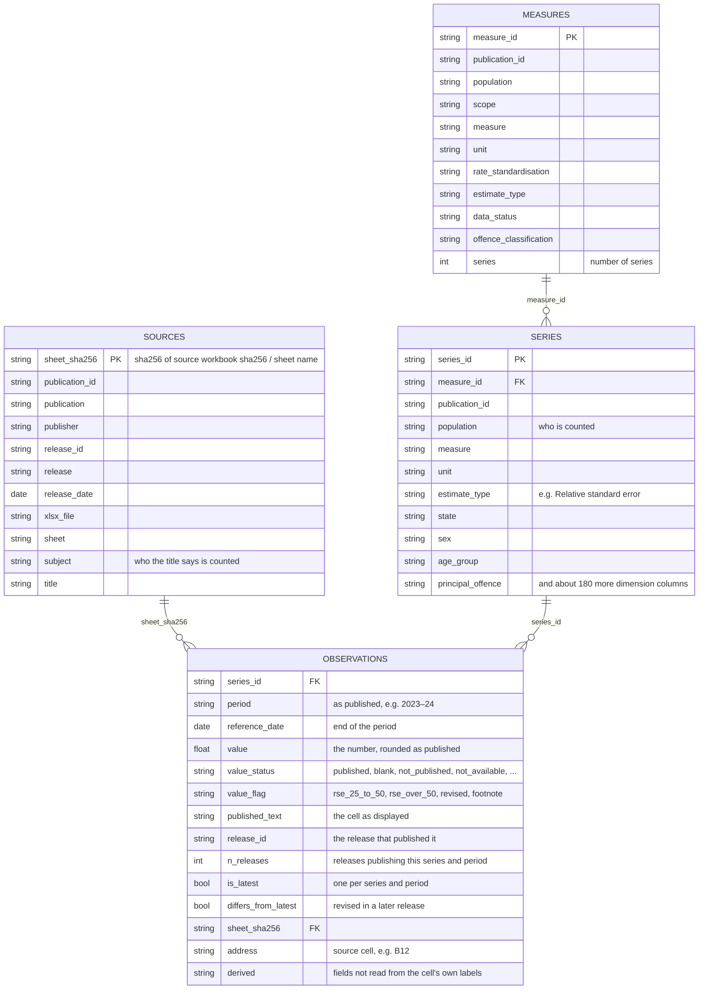
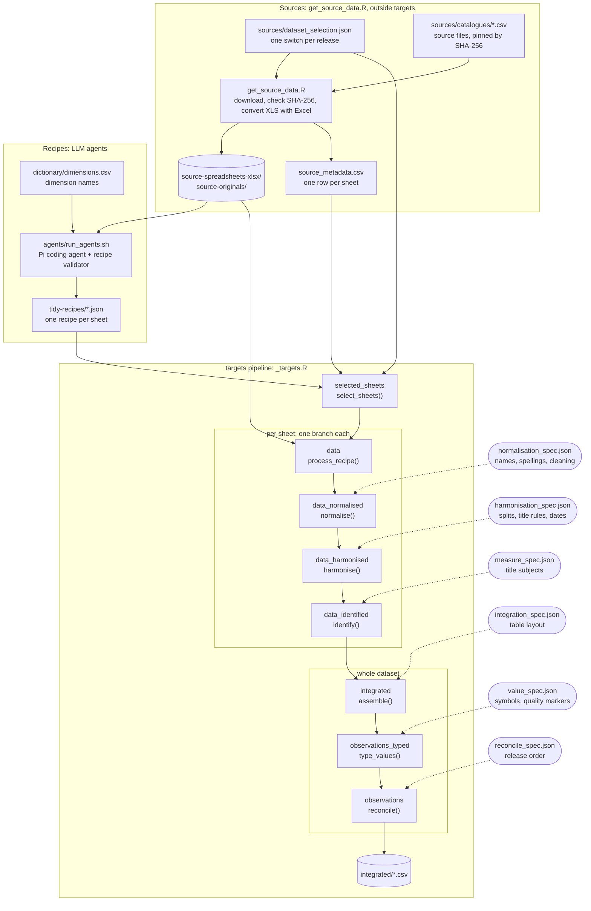

# tidy-pipeline

An R [`targets`](https://docs.ropensci.org/targets/) pipeline that turns published
Australian justice and crime statistics spreadsheets into one integrated, tidy dataset:
one row per published value, with every dimension needed to interpret it, linked back
to its source workbook and cell.

**The dataset:** download the zipped CSVs from the
[latest release](https://github.com/ianmoran11/tidy-pipeline/releases/latest). It holds
3,989,690 values in 721,701 series from 129 releases of 10 publications by the ABS,
AIHW and Productivity Commission (2001–2025). `integration/README.md` is the data
dictionary.

| File | One row per |
|---|---|
| `observations.csv` | published value: series, period, reference date, value, status (published / not published / not available / blank …), quality flag (e.g. relative standard error 25–50%), release, whether it's the latest release's value, source sheet and cell |
| `series.csv` | series: publication, what is counted (population, measure, unit, estimate type …) and one column per dimension (state, sex, age group, offence, court level …) |
| `measures.csv` | measure: the measure catalogue |
| `sources.csv` | source sheet: publication, release, workbook, sheet, title |

### Data model



A *series* is everything that identifies a value except its period: the publication,
what is counted (the measure fields, which make up `measure_id`) and one column per
dimension. A dimension a series doesn't have is empty, which means its total.
`release_id` in `observations` names the release; `sources.csv` gives its date and
name.

```r
library(dplyr)
obs <- readr::read_csv("observations.csv")
series <- readr::read_csv("series.csv")
obs |> filter(is_latest) |> inner_join(series, by = "series_id") |>
  filter(publication_id == "prisoners-australia", measure == "Imprisonment rate")
```

## How it works



Each stage is a short R function driven by a JSON spec. The specs hold the knowledge
about the sources, so adding a publication mostly means adding spec entries, not code.
Every data target also has a check function (`R/check_*.R`, 78 tests); failures are
collected in the `check_failures` target. Switching a release on or off, or editing one
recipe, reruns only the affected branches.

```
sources/dataset_selection.json   release switches (true/false) and pinned source catalogues
get_source_data.R                downloads, checks and converts selected workbooks -> source_metadata.csv
tidy-recipes/*.json              one recipe per sheet: where its values and labels are (written by LLM agents)
_targets.R                       extract -> normalise -> harmonise -> identify -> assemble -> type -> reconcile -> CSV
normalisation/, harmonisation/,  JSON specs that drive each stage: the code is small, the knowledge is in the specs
measures/, integration/
dictionary/dimensions.csv        the dimension names recipes use
R/check_*.R                      one check function per data target (78 tests)
agents/                          the recipe-writing agent harness (Pi coding agent)
orchestrator/                    project handover: state, decisions, known issues, data notes, QA scripts
```

Start with [`orchestrator/README.md`](orchestrator/README.md). Then:
- [`sources/README.md`](sources/README.md) explains adding releases;
- [`integration/README.md`](integration/README.md) describes the output tables;
- [`orchestrator/ISSUES.md`](orchestrator/ISSUES.md) lists known limitations.

### Running it

Requires R with `targets`, `tarchetypes`, `crew`, `qs2`, `tidyverse`, `tidyxl`,
`unpivotr`, `cellranger`, `openxlsx`, `jsonlite`, `data.table` and `openssl`.

```r
targets::tar_make()   # about 1.5 hours from scratch for 9,040 sheets on 6 workers
```

Adding a release: switch it on in `sources/dataset_selection.json`, then run
`Rscript get_source_data.R`. That downloads and checks the files; converting XLS needs
Microsoft Excel on macOS. Then write recipes for the new sheets
(`agents/run_agents.sh`) and run `tar_make()`.

`source-originals/` holds the original downloads (XLS, XLSX, ZIP members) of every
source file prepared by `get_source_data.R`, each matching its SHA-256 pin in
`sources/catalogues/`. The reference SQLite database used for quality checks during
development is not included.

## Licence

- **The project's own work** (code, recipes, specs, dictionary, documentation): MIT
  ([`LICENSE`](LICENSE)). Any use is fine.
- **The publishers' statistics** (the spreadsheets in `source-spreadsheets-xlsx/` and
  the integrated dataset derived from them): Creative Commons Attribution 4.0, which
  allows any use with attribution. See [`DATA-LICENSE.md`](DATA-LICENSE.md).
